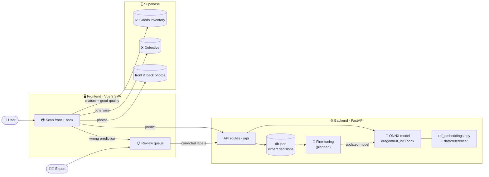
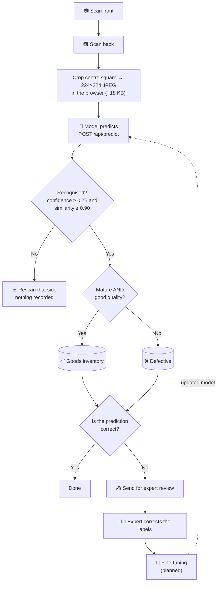
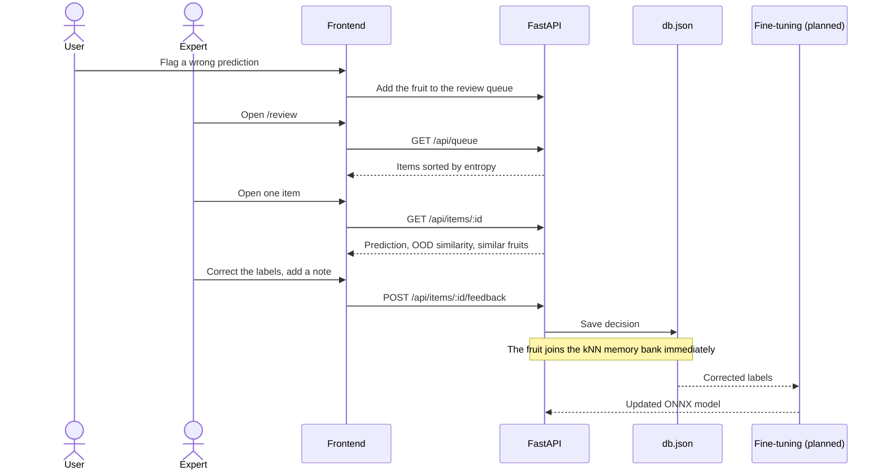
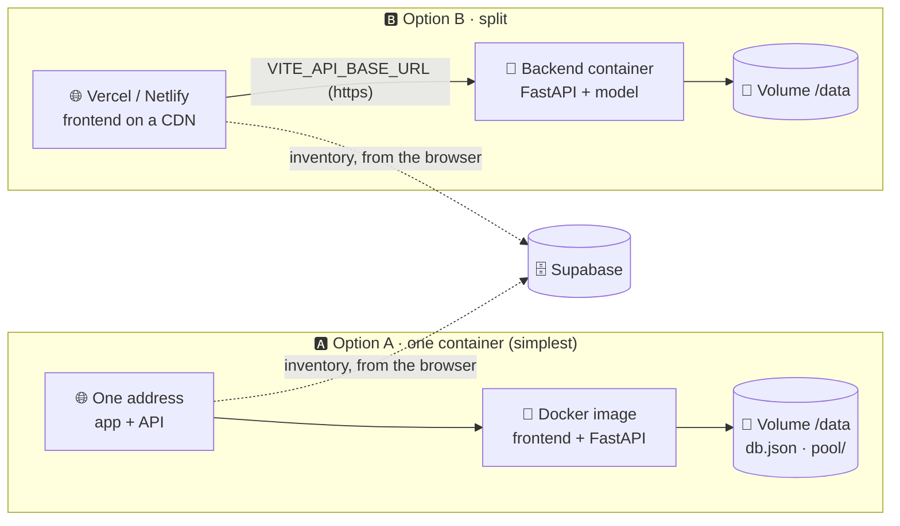

<div align="center">

# 🐉 Dragon Fruit Expert Review

**Expert-in-the-loop maturity and quality grading of dragon fruit**

An ONNX vision model grades each fruit from a front and back photo, flags images it doesn't recognise, and learns from expert corrections, with an inventory of every graded fruit.


<br/>


</div>

---

## 📑 Contents

- [✨ Features](#-features)
- [🏗️ Architecture](#️-architecture)
- [📁 Project structure](#-project-structure)
- [🚀 Quick start (local)](#-quick-start-local)
- [🖥️ Using the app](#️-using-the-app)
- [⚙️ Configuration](#️-configuration)
- [🧠 Backend details](#-backend-details)
- [🔌 API reference](#-api-reference)
- [☁️ Deployment](#️-deployment)
- [🛠️ Troubleshooting](#️-troubleshooting)
- [🔒 Before real users](#-before-real-users)

---

## ✨ Features

| | Feature | What it does |
|---|---|---|
| 📷 | **Quick grade** | Photograph the front and back of one fruit and get its maturity and quality in seconds. Works with the live camera Scan, a photo, or an upload. |
| 🛡️ | **Out-of-distribution check** | Each photo is compared against 2,131 reference images. Anything the model doesn't recognise is rejected instead of guessed. |
| ✅ | **Goods / Defective sorting** | Mature, good-quality fruits go to the Goods inventory; everything else goes to Defective. |
| 🧑‍🔬 | **Expert review & fine-tuning** | Wrong predictions are sent to an expert, who corrects the labels. Corrections feed the kNN memory bank and fine-tuning (planned). The queue is ranked by entropy, with keyboard shortcuts. |
| 🔍 | **Similar reference fruits** | Every prediction shows the most similar known fruits (kNN), so experts can see why the model decided. |
| 📦 | **Inventory** | Every graded fruit is stored in Supabase with both photos. |
| 📊 | **Dashboard & history** | Agreement vs. correction rates and Cohen's kappa between model and expert. |

> The frontend contains **no ML code**. Every prediction, OOD score, neighbor and metric comes from the backend; inventory counts come from Supabase.

---

## 🏗️ Architecture



---

## 📁 Project structure

```
MY-THESIS/
├── 🖥️ frontend/                Vue 3 + TypeScript + Vite + Pinia + Vue Router + Tailwind 4 + shadcn-vue + Chart.js
│   ├── src/
│   │   ├── views/auth/         LoginView (username + password)
│   │   ├── views/worker/       MyDashboardView (own counts)
│   │   ├── views/admin/        Dashboard · Inventory · Workers · ModelMetrics
│   │   ├── views/admin/review/ ReviewQueue · ExpertReview · History
│   │   ├── views/shared/       QuickGradeView (admin "Quick grade" and worker "Scan")
│   │   ├── components/dashboard/ CountTiles · DailyChart · BinBreakdown
│   │   ├── stores/auth.ts      signed-in account and role
│   │   └── config/labels.ts    labels, thresholds, MODEL_INPUT_SIZE
│   ├── supabase/               schema.sql (tables, photos) · auth-roles.sql (functions, roles)
│   ├── vercel.json / netlify.toml / .npmrc
│   └── .env.example
│
├── ⚙️ backend/                 FastAPI server that runs the ONNX model
│   ├── main.py                 assembles the app (CORS, media, frontend)
│   ├── grading/                config · model (ONNX) · references (OOD) · store (decisions)
│   │                           · scoring · service · routes (/api)
│   ├── evaluate.py
│   ├── extract_reference.py    fills data/reference/ from the dataset zips
│   ├── requirements.txt
│   ├── Dockerfile              backend-only image (Option B)
│   ├── model/deploy/           dragonfruit_int8.onnx · ref_embeddings.npy · splits.csv · config.json
│   └── data/
│       ├── pool/               unlabeled images waiting for review
│       ├── reference/          2,131 train images
│       └── db.json             expert decisions
│
├── 🐳 Dockerfile               frontend + backend in one image (Option A)
├── fly.toml                    Fly.io config
└── render.yaml                 Render blueprint
```

---

## 🚀 Quick start (local)

### Prerequisites

- **Python** with `pip`
- **Node.js** 22 or 24
- A **Supabase** project (optional; without it the inventory is disabled)

### Step 1 · Start the backend

```sh
pip install -r backend/requirements.txt
cd backend
python -m uvicorn main:app --port 8000
```

✅ Check: open <http://localhost:8000/api/health>.

### Step 2 · Load the reference images (once)

Needed for the "Similar reference fruits" panel. Without it, only expert-reviewed fruits appear there.

```sh
cd backend
python extract_reference.py "<maturity dataset>.zip" "<quality dataset>.zip"
```

### Step 3 · Set up Supabase (once)

In the Supabase **SQL editor**, run in this order:

1. `frontend/supabase/schema.sql` — tables and photos: `profiles` (name, role), `credentials` (username, bcrypt password hash), `sessions` (sign-in tokens), `gradings` (front/back photo, worker) and the photo bucket
2. `frontend/supabase/auth-roles.sql` — functions and roles: `login`, `create_admin`, `create_worker`, `record_grading`, `count_scans` and the rest

Both are safe to run again.

Accounts do **not** use Supabase Auth; the app only uses the anon key. The anon key cannot read any table directly (Row Level Security with no policies). Everything goes through the functions in `auth-roles.sql`, which check the session token, so the password hashes are never exposed and a worker only ever gets their own fruit.

Then create the admin in the SQL editor (the app has no registration page; this function cannot be called from the app):

```sql
select create_admin('admin', 'Farm Admin', 'your-password');
```

Sign in with that username and password. The admin registers each worker on the **Workers** page. Admins and workers use the same sign-in page.

### Step 4 · Start the frontend

Open a second terminal:

```sh
cd frontend
npm install --legacy-peer-deps   # the scaffold's ESLint peer ranges conflict with TypeScript 6
cp .env.example .env.local       # Windows cmd: copy .env.example .env.local
```

Edit `.env.local` (see [Environment variables](#environment-variables-frontendenvlocal)), then:

```sh
npm run dev                      # http://localhost:5173
```

✅ Open <http://localhost:5173>.

### Other scripts

| Command | Purpose |
|---|---|
| `npm run build` | Type-check (`vue-tsc`) + production build |
| `npm run lint` | Lint the frontend |
| `npm test` | Unit tests (Vitest) |

---

## 🖥️ Using the app

### Pages

Everyone signs in at `/login` with a username and password. What they see depends on their role.

**Worker** (farm staff) — scans fruit and sees only their own count:

| Route | Page | Purpose |
|---|---|---|
| `/scan` | 📷 Scan | Grade one fruit from two photos; it is saved under the worker's name |
| `/my-dashboard` | 📊 My dashboard | Today, this week, total, last 14 days and bins — own scans only |

**Admin** — monitors the inventory and every worker:

| Route | Page | Purpose |
|---|---|---|
| `/dashboard` | 📊 Dashboard | Farm totals, scans per worker, last 14 days, bins |
| `/inventory` | 📦 Inventory | Every scanned fruit with photos and who scanned it; filter by worker; delete |
| `/workers` | 👥 Workers | Add workers, disable/enable, reset passwords |
| `/grade` | 📷 Quick grade | Grade one fruit with the model's full evidence |
| `/review` | 📋 Review queue | Uncertain images for experts |
| `/review/:id` | 🧑‍🔬 Expert review | Confirm or correct one image |
| `/history` | 🕘 History | Past expert decisions |
| `/model` | 📈 Model metrics | Agreement, kappa and model accuracy |

A worker cannot see another worker's fruit or counts. This is enforced in the database functions (`auth-roles.sql`), not only by the app.

### 📷 Quick grade (two sides)

1. Scan the **front** of the fruit.
2. Scan the **back** of the same fruit. Both are required.
3. Press **Grade this fruit**. The model predicts maturity and quality.
4. The fruit is stored automatically:
   - **Mature and good quality** → ✅ **Goods** inventory
   - **Anything else** → ❌ **Defective**
5. If the prediction looks wrong, send the fruit for **expert review**. The expert's corrected labels are used to fine-tune the model.



A fruit is saved with **both** photos or not at all: if either photo or the record fails to save, nothing is kept and the page says so.

**How the two sides combine:** maturity is the **average** of both sides; quality follows the **worse** side; OOD similarity is the **lowest** of the two.

**About the 224 × 224 photo:** every photo (taken, uploaded or from the live Scan) is resized once in the browser. That single image is what the model reads, what the page shows and what Supabase stores. Tested on 80 dataset images and 8 phone photos: labels did not change and confidence moved by at most 0.04.

### 🧑‍🔬 Expert review loop



### ⌨️ Keyboard shortcuts (expert review)

| Key | Action |
|---|---|
| <kbd>M</kbd> / <kbd>Q</kbd> | Switch task (Maturity / Quality) |
| <kbd>C</kbd> | Confirm the active task |
| <kbd>A</kbd> | Confirm both tasks |
| <kbd>1</kbd> / <kbd>2</kbd> | Pick a label |
| <kbd>Enter</kbd> | Submit |
| <kbd>←</kbd> / <kbd>→</kbd> | Previous / next item |

Shortcuts are ignored while typing in the note field.

---

## ⚙️ Configuration

### Environment variables (`frontend/.env.local`)

| Variable | Meaning |
|---|---|
| `VITE_API_BASE_URL` | Backend origin, no trailing slash (e.g. `http://localhost:8000`) |
| `VITE_SUPABASE_URL` | Supabase project URL. Leave empty to disable the inventory |
| `VITE_SUPABASE_ANON_KEY` | Supabase anon/publishable key |

### Labels and thresholds (`frontend/src/config/labels.ts`)

| Setting | Default | Rule |
|---|---|---|
| Label `value`s | — | Must match `classes` in `backend/model/deploy/config.json`. Array order sets the number-key shortcuts |
| `CONFIDENCE_THRESHOLD` | `0.75` | Below this, a photo is rejected |
| `SIMILARITY_THRESHOLD` | `0.90` | Below this, a photo is rejected as unfamiliar |
| `MODEL_INPUT_SIZE` | `224` | Must match `input.size` in `config.json` |

> 💡 To switch to another grading standard (e.g. **PNS/BAFPS 115:2013**), edit the labels in this file and make sure they match the model's `classes`.

---

## 🧠 Backend details

The backend loads the model named in `backend/model/deploy/config.json` and applies its preprocessing: EXIF rotation → centre crop → 224 × 224 → mean/std normalisation.

| Topic | How it works |
|---|---|
| 📋 **Review queue** | Drop unlabeled images into `backend/data/pool/`. They are predicted on the next queue request and sorted by entropy. |
| 🔍 **Similar reference fruits** | The 2,131 train images behind `ref_embeddings.npy` (rows match the train split of `splits.csv`), plus expert-reviewed fruits. Each reference has only one label (maturity *or* quality) because the two datasets are separate. |
| 💾 **Expert feedback** | Saved in `backend/data/db.json`. These fruits form the kNN memory bank. Deleting `db.json` clears History and the memory bank. |
| 🛡️ **OOD detection** | `oodSimilarity` = mean of the top-k cosine similarities to `ref_embeddings.npy`. An image is flagged when either task's confidence or `oodSimilarity` is below its threshold. OOD uploads are never added to the inventory. |
| 🚫 **No Grad-CAM** | The ONNX model has no heatmap output, so heatmap controls are hidden. `/api/metrics` returns empty evaluations and no consolidation run, as there is no evaluation or fine-tuning pipeline. |
| 🌐 **CORS** | Allows `http://localhost:5173` by default. Set `CORS_ORIGINS` (comma separated) to change it. |

---

## 🔌 API reference

Relative image URLs (e.g. `/media/a.jpg`) are resolved against `VITE_API_BASE_URL`. Confidence is 0–1; entropy is the sum over both tasks (nats).

| Method | Path | Request | Response |
|---|---|---|---|
| `GET` | `/api/health` | — | Health check |
| `GET` | `/api/queue?limit=&offset=` | — | `[{id, imageUrl, maturity:{label,confidence}, quality:{label,confidence}, entropy}]` |
| `GET` | `/api/items/:id` | — | Queue item + `gradcamUrl` (empty) + `oodSimilarity` + `neighbors:[{id, imageUrl, maturityLabel, qualityLabel, similarity}]` |
| `POST` | `/api/items/:id/feedback` | JSON `{maturityLabel, qualityLabel, note?}` | `204` — adds the image to the kNN memory bank immediately |
| `POST` | `/api/predict` | multipart: `image` (front, required), `back` (optional) | Same shape as `GET /api/items/:id`, plus `views` (one reading per side). Stateless; nothing is stored |
| `GET` | `/api/metrics` | — | `{labelCount, expertQueries, correctionsApplied, evaluations:[{date, accuracy, macroF1}], rounds:[{round, queries, corrections}], lastConsolidation:{runAt, status, accuracyBefore?, accuracyAfter?, reason?} \| null}` |
| `GET` | `/api/history` | — | `[{id, itemId, imageUrl, modelMaturity, modelQuality, expertMaturity, expertQuality, note?, timestamp}]` |

Agreed vs. corrected and Cohen's kappa are computed in the browser from `/api/history`.

---

## ☁️ Deployment

The backend needs a host that runs a **container with a persistent disk**: the expert decisions (`db.json`), the review pool and the 272 MB of reference images must survive restarts. Vercel and Netlify functions only have a temporary `/tmp`, so they **cannot** host the backend.



| | Option A · one container | Option B · split |
|---|---|---|
| Hosts | Fly.io, Render, Railway or a VPS | Vercel/Netlify + a container host |
| CORS setup | Not needed | Set `CORS_ORIGINS` |
| `VITE_API_BASE_URL` | Not needed | Required |
| Best for | Getting online quickly | Serving the frontend from a CDN |

### 🅰️ Option A — everything in one container

The root `Dockerfile` builds the frontend and places it inside the backend image, so one container serves the app and the API from one address.

```sh
docker build -t dragonfruit \
  --build-arg VITE_SUPABASE_URL=https://xxxx.supabase.co \
  --build-arg VITE_SUPABASE_ANON_KEY=... .
```

Deploy the image on a host with a persistent disk, using the [backend settings](#backend-settings). Tested locally without Docker: the server serves the app, deep links such as `/inventory`, the API and the images from one origin.

<details>
<summary><b>🪁 Fly.io, step by step</b></summary>

`fly.toml` is ready: Singapore region, 1 GB machine, 1 GB volume at `/data`, health check on `/api/health`, one machine only.

1. Log in and create the app (pick another name if it's taken, and update `fly.toml`):
   ```sh
   fly auth login
   fly apps create dragonfruit-grading
   ```
2. Create the volume:
   ```sh
   fly volumes create dragonfruit_data --region sin --size 1
   ```
3. Deploy:
   ```sh
   fly deploy --ha=false \
     --build-arg VITE_SUPABASE_URL=https://xxxx.supabase.co \
     --build-arg VITE_SUPABASE_ANON_KEY=...
   ```
4. Open `https://<app name>.fly.dev`.
5. Add photos to the review queue:
   ```sh
   fly ssh sftp shell
   > put C:\photos\IMG_001.jpg /data/pool/IMG_001.jpg
   ```

> ⚠️ Keep to **one machine** (`--ha=false`): a Fly volume belongs to a single machine, and expert decisions are held by one process. The machine and the volume are billed; check Fly's current pricing.

</details>

<details>
<summary><b>🟣 Render, step by step</b></summary>

`render.yaml` is a blueprint: Docker service, Singapore region, `starter` plan, 1 GB disk at `/data`, health check on `/api/health`.

1. Push the project to a GitHub or GitLab repository. Render deploys from a repository.
2. In Render, choose **New → Blueprint** and pick the repository.
3. Enter `VITE_SUPABASE_URL` and `VITE_SUPABASE_ANON_KEY` when asked. Render passes them to the Docker build as build arguments. The anon key is public by design.
4. Open the address Render gives you (e.g. `https://dragonfruit-grading.onrender.com`).
5. To fill the review queue, copy photos into `/data/pool` using Render's shell, or SFTP over SSH from the service's **Connect** menu.

**Notes**

- **Free plan:** only Quick grade and Inventory work (their data is in Supabase). A free service has no persistent disk, so History, the memory bank and the review pool are erased on every restart. It also sleeps after 15 minutes without traffic, so the next visitor waits while the model loads. Use a paid plan with the disk for the review queue.
- Measured memory peaks around 200 MB, so the smallest paid instance is enough; confirm sizes on Render's pricing page.
- A service with a disk runs as a single instance, which is what this app needs.

</details>

### 🅱️ Option B — frontend on Vercel/Netlify, backend in a container

#### 1. Backend (container)

Build from the `backend` folder:

```sh
cd backend
docker build -t dragonfruit-api .
```

#### Backend settings

*(also apply to Option A)*

| Setting | Value |
|---|---|
| Port | The host's `PORT` is used automatically (default `8000`) |
| Health check path | `/api/health` |
| Persistent volume | Mount at `/data` (this is `DATA_DIR`: `db.json` and `pool/` live there) |
| `CORS_ORIGINS` | Your frontend address, e.g. `https://your-app.vercel.app` (comma separated for several). Option B only |
| Memory | 512 MB is enough (measured: ~130 MB at start, ~200 MB with 20 gradings at once); 1 GB leaves room |

- ⚠️ Keep **one worker**. Expert decisions live in memory and are saved to a single JSON file, so several workers would overwrite each other.
- ⚠️ Without a persistent volume, every restart erases History, the memory bank and the review pool.
- The image is about **0.6 GB** because the 2,131 reference photos are baked in.
- Put photos to review in `/data/pool`.

#### 2. Frontend (Vercel or Netlify)

Import the project and set:

| Setting | Value |
|---|---|
| Root Directory | `frontend` (build settings come from `frontend/vercel.json`) |
| Node.js version | 22 or 24 |
| `VITE_API_BASE_URL` | Backend address, **https**, no trailing slash |
| `VITE_SUPABASE_URL` / `VITE_SUPABASE_ANON_KEY` | From your Supabase project |

- Environment variables are baked in at build time: **redeploy after changing them**.
- On Netlify, `frontend/netlify.toml` is used instead of `vercel.json`; set the same variables in the site settings.
- `frontend/.npmrc` handles the peer-dependency conflict, and `vercel.json` rewrites every path to `index.html` so refreshing `/inventory` doesn't 404.

#### 3. Supabase

Run `frontend/supabase/schema.sql`, then `auth-roles.sql` (both safe to run again), then create the admin with `select create_admin(...)` as in Step 3.

---

## 🛠️ Troubleshooting

| Problem | Fix |
|---|---|
| `npm install` fails with peer-dependency errors | Use `npm install --legacy-peer-deps` |
| Camera / live Scan doesn't start | The camera only works on **https** pages (or localhost) |
| "Similar reference fruits" shows only reviewed fruits | Run `extract_reference.py` to fill `backend/data/reference/` |
| History and review pool vanish after a restart | The host has no persistent volume. Mount one at `/data` |
| CORS error in the browser console | Add the frontend address to `CORS_ORIGINS` on the backend |
| New env values aren't used | `VITE_*` values are baked in at build time. Rebuild / redeploy |
| Refreshing `/inventory` gives 404 | Make sure `vercel.json` (or `netlify.toml`) is in the `frontend` root |
| Inventory page is empty or disabled | Check `VITE_SUPABASE_URL` and that the SQL scripts were run |
| "Could not find the function ..." | Run `auth-roles.sql` in Supabase |
| Forgot the admin password | In the SQL editor: `update credentials set password_hash = extensions.crypt('new-password', extensions.gen_salt('bf')) where username = 'admin';` |

---

## 🔒 Before real users

These are left open on purpose for the demo. Close them before sharing the link:

- [ ] **Add a login to the backend.** Right now anyone can read the queue and post feedback.
- [x] **Tighten Supabase policies.** Done by `auth-roles.sql`: tables are reached only through functions that check the sign-in, workers see only their own fruit, only the admin can delete.
- [ ] **Photos are open.** Anyone with the anon key can upload, list and delete files in the `gradings` bucket (needed because accounts do not use Supabase Auth).
- [ ] Serve the app over **https** (required for the camera anyway).
